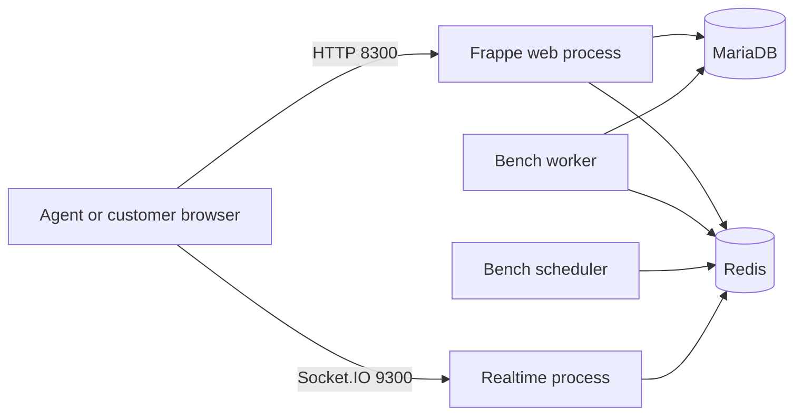

# Architecture

This guide describes the checked-out Helpdesk 1.31.0 `main` baseline. The evaluation additions only configure development infrastructure, seed data and documentation; the product's controllers and Vue components are unchanged.

## Runtime

Root Compose starts MariaDB 10.11, Redis 7 and a Bench container. Bench's development Procfile supervises the Python web server, Socket.IO server, scheduler and worker. Redis supplies cache and background job queues. MariaDB stores site documents. The Bench volume holds the Frappe and Telephony source, Python environment, site configuration/files, logs and built assets. The host Helpdesk checkout is mounted into `apps/helpdesk` for editing.

This follows the upstream Bench-based Docker development approach. Production process supervision, HTTPS, backup automation and email delivery are outside this evaluation setup.

## Backend

Frappe is a Python framework with a document ORM, metadata-driven schema, permissions, sessions, HTTP APIs, jobs and website rendering. Helpdesk is an installed Frappe app. Telephony is a required app dependency; it does not require a live phone provider for ticket evaluation.

`helpdesk/helpdesk/doctype/` contains DocTypes. Each DocType's JSON defines fields, child tables, permissions and naming; its Python controller defines validation and lifecycle behavior. Frappe synchronizes these definitions into MariaDB during app installation/migration. For example, `HD Ticket` connects contacts, customers, teams, priorities, statuses and SLAs. Conversations are native Frappe `Communication` records; current internal ticket comments use Frappe `Comment`. Older HD comment/activity DocTypes remain in the tree.

`helpdesk/api/` provides whitelisted RPC endpoints. Frappe dispatches `/api/method/<python.dotted.path>` and generic `/api/resource/<DocType>` document APIs. Some document methods are exposed through `frappe.desk.form.run_method`. An endpoint must validate permissions; `@frappe.whitelist()` alone is not an authorization policy.

`helpdesk/hooks.py` connects install/migration actions, document events, scheduled jobs, website routing, permission functions and framework overrides. Permissions combine DocType roles with per-record checks and query conditions. Agents, Agent Managers, customer members and customer managers have different visibility. Never bypass these checks in a product endpoint because a developer seeder uses Administrator.

Background jobs use Frappe queues/workers. Scheduled tasks include search indexing, corpus preparation, SLA status updates and closing old tickets. Socket.IO broadcasts ticket/agent events to subscribed clients. Email ingestion is implemented through Frappe Email Account/Communication with Helpdesk overrides. The evaluation environment disables sending email but retains in-app conversations.

## Frontend

`desk/` is the current Vue 3 single-page application. It uses TypeScript and JavaScript, Vue Router, Pinia, Vite 5, Tailwind CSS 3, Frappe UI and a linked `@framework/ui` package from `apps/frappe/ui`. Rich text uses Tiptap. Socket.IO client handles realtime updates. The exact dependency versions and overrides are in `desk/package.json` and `desk/yarn.lock`.

Agent desk and customer portal share the same application. Routes are defined in `desk/src/router/index.ts` with the `/helpdesk` base. Agent tickets use `/helpdesk/tickets`; customers use `/helpdesk/my-tickets`; public articles use `/helpdesk/kb-public`. Route guards and portal layouts select the appropriate interface, while backend permission checks enforce access.

`desk/src/pages/` contains page views, `desk/src/components/` reusable and feature components, `desk/src/stores/` Pinia stores, and `desk/src/composables/` reusable reactive behavior. `desk/src/main.js` is the entry point. Frappe UI resource helpers connect views to HTTP endpoints. The top-level `frappe-ui` Git submodule is available for upstream UI development; normal builds use the package selected by the lockfile and Vite configuration.

Vite writes the compiled bundle into `helpdesk/public/desk` and the boot template into `helpdesk/www/helpdesk/index.html`. These generated paths are ignored. Frappe's website route rules serve the SPA for `/helpdesk/*`. `helpdesk/www/` and templates supply server-rendered boot context. A 200 response for the HTML shell alone does not prove the JavaScript application works; browser checks are required too.

## Directory map

| Path | Responsibility |
| --- | --- |
| `helpdesk/helpdesk/doctype/` | Domain models, validation, DocType metadata |
| `helpdesk/api/` | HTTP/RPC API functions |
| `helpdesk/hooks.py` | Framework integration points |
| `helpdesk/overrides/`, `helpdesk/extends/` | Framework subclass overrides and document hooks |
| `helpdesk/integrations/erpnext/` | Optional ERPNext customer synchronization |
| `helpdesk/setup/`, `helpdesk/patches/` | Installation defaults and migrations |
| `helpdesk/config/` | Frappe app configuration |
| `helpdesk/notifications.py`, `helpdesk/search*.py` | Notifications and search |
| `desk/src/` | Shared agent/customer SPA source |
| `e2e/`, `helpdesk/tests/` | Upstream integration/browser tests |
| `helpdesk/demo/` | This fork's opt-in development fixture generator |
| `docker/dev-init.sh`, `compose.yaml` | This fork's persistent local development stack |

No separate customer frontend service or custom ticket backend was added. The standalone `shared/`, `studio/` or `realtime/` folders visible on other upstream branches are not part of this `main` checkout; use the files in this branch as the reference.
